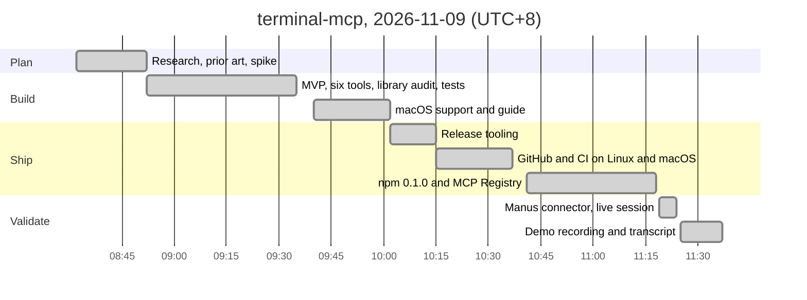
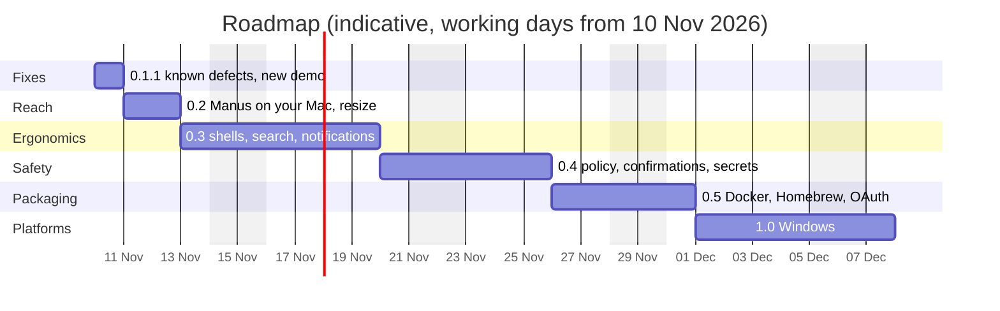

# Status and roadmap

**Against the original brief: 8 of 8 requirements met.** An MCP client can create terminal sessions, run commands, keep reading output, type into interactive programs, see the running state and terminate sessions. It has been verified with real clients, including Manus.

**Against the full product plan: 24 of 45 features done (53%), 2 partly done.** The rest is hardening and reach: safety policy, more shells, packaging and Windows.

Status as of 2026-11-09, version 0.1.0.

## The brief, requirement by requirement

| Requirement from the brief | Status | How it is met | Evidence |
|---|---|---|---|
| Create and control local terminal sessions | Done | `terminal_start` opens a real pseudo-terminal running a shell or any program (REPL, vim, dev server, ssh), with a name for later calls | Tests; [demo](docs/demo.gif) step 1 |
| Start commands | Done | `terminal_exec` returns only that command's output, its exit code and the new working directory, through VS Code's shell integration in bash and zsh | Tests on bash 3.2, bash 5 and zsh |
| Keep reading output | Done | Long commands return early with a cursor; `terminal_read` pages forward without gaps or repeats, waits for output, a regex, the command's end or exit, and reports lost output | Tests; demo step 3 |
| Write to interactive processes | Done | `terminal_write` sends text, named keys (ctrl+c, arrows, f-keys) and bracketed paste; prompts and password prompts are detected | Tests with a REPL, `read -p`, a password prompt and vim |
| Know the running state | Done | running or exited, busy or idle, `awaiting_input`, current command and how long it has run, last command with exit code and duration | `terminal_list`; tests |
| Terminate a session when needed | Done | `terminal_kill` stops the whole process tree (SIGHUP, then SIGKILL); every session is cleaned up when the client disconnects | Tests; demo step 7 |
| A reliable terminal capability, not one wrapped command | Done | Shell state persists between calls; memory is bounded under output floods; session limits and idle timeout; agent commands stay out of shell history | 91 tests on Ubuntu and macOS, Node 22 and 24 |
| Connect to any MCP client, for example Manus | Done | stdio for local clients, Streamable HTTP with a bearer token for remote ones, both MCP protocol generations; on npm and the MCP Registry | [Manus transcript](docs/demo-manus.md), MCP Inspector, Claude Code-style stdio client |

Two small defects are known and scheduled for 0.1.1:
- While a command is still running, its partial output starts with the echoed command line.
- A session ended by a signal reports `exit_code: 0` next to `exit_signal`, instead of no exit code.

## Timeline so far

Everything up to the first release was built on 2026-11-09 (times in UTC+8).

| Time (UTC+8) | Milestone |
|---|---|
| 08:32 to 08:52 | Brief, research into MCP 2026-07-28, SDK v2 and existing terminal servers; a throwaway spike passed 25 of 25 checks; feasibility and build plan |
| 08:52 to 09:35 | MVP: six tools on node-pty, xterm headless and VS Code shell integration, library audit, 82 end-to-end tests over stdio and HTTP |
| 09:40 to 10:02 | macOS: node-pty `spawn-helper` permission fix, support for macOS's bash 3.2, smoke and Inspector scripts, macOS guide |
| 10:02 to 10:15 | Release tooling: `server.json`, release workflow, publishing guide |
| 10:15 to 10:37 | GitHub repository and CI on Ubuntu and macOS; fixed zsh stopping at a startup question |
| 10:41 to 11:18 | Public repository; readiness fix for slow-starting programs; Node 22.12 minimum; **0.1.0 on npm** with provenance (11:11) and **in the MCP Registry** (11:17) |
| 11:19 to 11:24 | **Manus validation:** connector created, then a shell, a REPL and a web server driven and killed by the Manus agent |
| 11:25 to 11:37 | Demo recording, Manus transcript, CI green on all four platform and Node combinations |

## Feature completeness

Grouped by the phases of the original build plan. "Partial" means usable, but not everything the plan describes.

| Area | Feature | Status | Notes |
|---|---|---|---|
| Core | Package, CLI, TypeScript build, CI on Ubuntu and macOS (Node 22, 24) | Done | |
| Core | Output journal with absolute cursors and a bounded ring buffer | Done | |
| Core | PTY sessions with a headless xterm screen view | Done | `view: "screen"` for vim, top, less |
| Core | Command tracking in bash and zsh: exit codes, cwd, busy and idle | Done | Includes macOS's bash 3.2 |
| Core | Event-driven waits: output, command end, exit, regex, quiet | Done | |
| Core | Session manager: session limit, idle timeout, cleanup on disconnect and signals | Done | |
| Core | Six tools with schemas, annotations, structured and plain-text results | Done | |
| Core | Process-tree kill with escalation; ctrl+c keeps the shell | Done | |
| Remote | Streamable HTTP with bearer token, Origin and Host checks, health check | Done | |
| Remote | Both MCP protocol generations (2025 and 2026-07-28) over stdio and HTTP | Done | |
| Remote | Secret-path token for clients that can only take a URL | Done | `--url-token` |
| Remote | Client setup docs: Claude Code, Cursor, Claude Desktop, MCP Inspector | Done | |
| Remote | Manus connector running in the Manus cloud computer | Done | [Transcript](docs/demo-manus.md) |
| Remote | Tunnel guide | Partial | ngrok documented; Cloudflare Tunnel and Tailscale Funnel not yet |
| Remote | Manus controlling terminals on your own Mac (HTTP plus tunnel) | Planned | Same HTTP path already tested through a public HTTPS URL with two clients |
| Agent ergonomics | Prompt and password-prompt detection (`awaiting_input`) | Done | |
| Agent ergonomics | Detection of questions a shell asks before its first prompt | Done | For example zsh's compinit |
| Agent ergonomics | Bracketed paste for multi-line input | Done | |
| Agent ergonomics | Named sessions | Done | |
| Agent ergonomics | Bounded memory under output floods, with lost-output reporting | Done | |
| Agent ergonomics | Agent commands kept out of shell history | Done | |
| Agent ergonomics | Soak tests with full-screen and interactive programs | Partial | vim, REPLs and output floods covered; htop, less and `npm create` not |
| Agent ergonomics | `terminal_resize` | Planned | |
| Agent ergonomics | fish and PowerShell command tracking | Planned | VS Code's scripts are already vendored |
| Agent ergonomics | Search the output history with a regex | Planned | |
| Agent ergonomics | Write very large outputs to a file and return its path | Planned | |
| Agent ergonomics | Progress notifications and MCP Tasks for long jobs | Planned | |
| Safety | Audit log of every tool call | Done | JSONL, on by default |
| Safety | Secret redaction in output and the audit log | Planned | |
| Safety | Policy file: allowed folders, environment allowlist, denied or confirm-first commands, read-only mode | Planned | |
| Safety | Confirmation prompts through MCP elicitation | Planned | |
| Safety | `send_secret`: passwords that reach the terminal without passing through the model | Planned | |
| Safety | Isolation: run sessions in a container or as a low-privilege user | Planned | |
| Safety | OAuth 2.1 for multi-user remote access | Planned | |
| Packaging | npm package with provenance | Done | `@ryamgoh/terminal-mcp` |
| Packaging | MCP Registry listing | Done | `io.github.ryamgoh/terminal-mcp` |
| Packaging | Tag-driven release workflow (tests, npm, registry) | Done | |
| Packaging | Docs: README, macOS guide, publishing guide, demo | Done | |
| Packaging | Docker image | Planned | |
| Packaging | Homebrew formula | Planned | |
| Packaging | Windows support (ConPTY and PowerShell) | Planned | |
| Extras | Live terminal view inside the client (MCP Apps) | Planned | |
| Extras | A human can watch and take over a session (web viewer or tmux backend) | Planned | |
| Extras | SSH sessions as a first-class session type | Planned | `ssh` already runs inside a session today |
| Extras | Sessions that survive a server restart | Planned | |

| Area | Done | Partial | Planned | Total |
|---|---|---|---|---|
| Core | 8 | 0 | 0 | 8 |
| Remote | 5 | 1 | 1 | 7 |
| Agent ergonomics | 6 | 1 | 5 | 12 |
| Safety | 1 | 0 | 6 | 7 |
| Packaging | 4 | 0 | 3 | 7 |
| Extras | 0 | 0 | 4 | 4 |
| **All** | **24** | **2** | **19** | **45** |

## Roadmap

Sizes are the original plan's estimates for one developer working full time. The calendar below assumes work continues from 10 November and skips weekends, so treat the dates as indicative. Today's work ran well ahead of the plan's estimates.

| Version | Scope | Estimate |
|---|---|---|
| 0.1.1 | Fix the two known defects; re-record the demo | Half a day |
| 0.2 | Manus on your own Mac: tunnel guide for ngrok, Cloudflare Tunnel and Tailscale Funnel, validated end to end; `terminal_resize` | 1 to 2 days |
| 0.3 | Agent ergonomics: fish and PowerShell, output search, large outputs to file, progress notifications and MCP Tasks, soak tests | 4 to 5 days |
| 0.4 | Safety: policy file, confirmations through elicitation, secret redaction, `send_secret`, optional isolation | 3 to 4 days |
| 0.5 | Packaging: Docker image, Homebrew formula, OAuth 2.1 for multi-user remote access | 2 to 3 days |
| 1.0 | Windows through ConPTY and PowerShell | About a week |
| Later | Live view through MCP Apps, human takeover, SSH sessions, sessions that survive restarts | Not scheduled |

